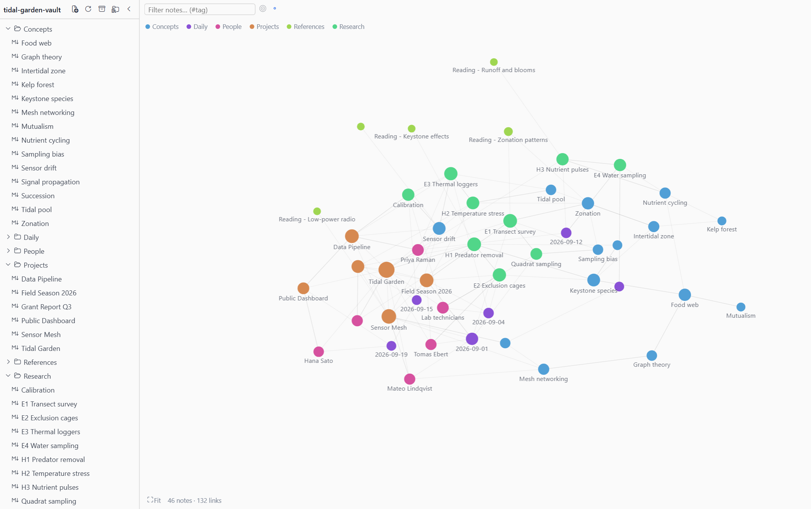
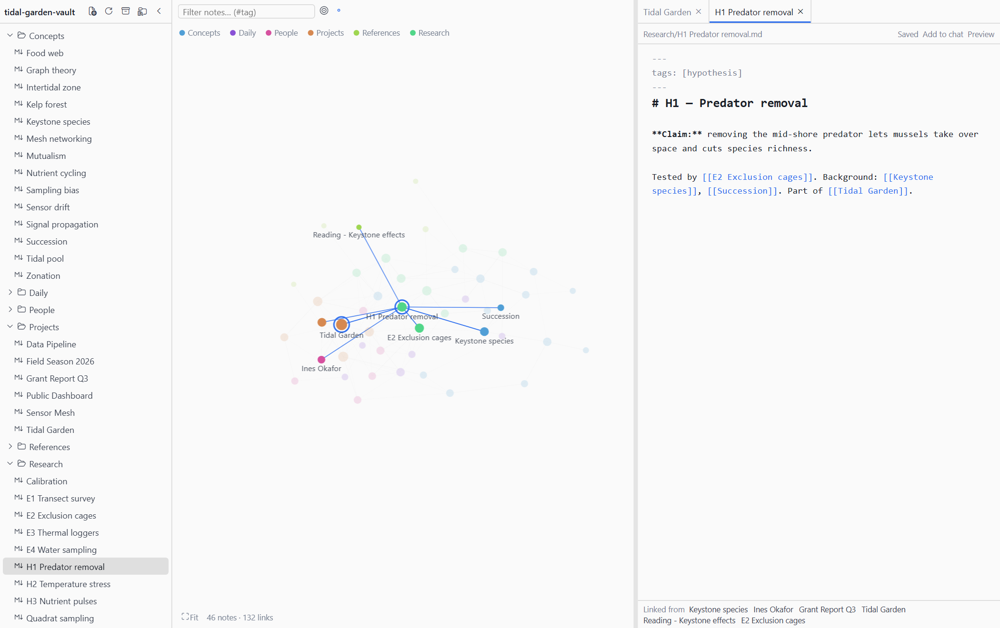
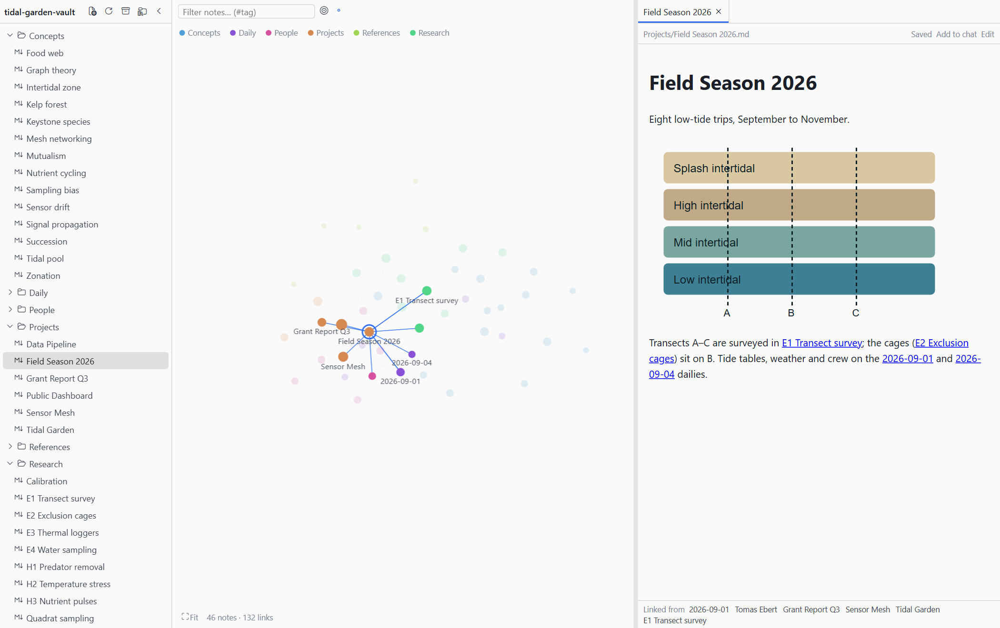
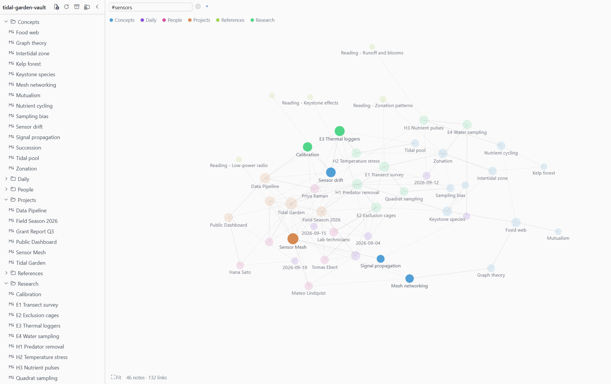
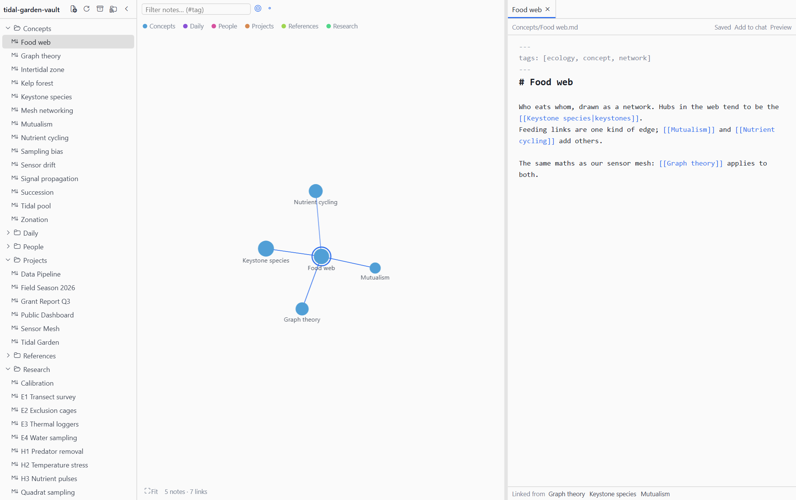

<div align="center">

# Plexus

Your markdown vault as a constellation, inside [Hermes Desktop](https://hermes-agent.nousresearch.com). One workspace tab holds a file tree, a force-directed graph of your notes and their `[[wikilinks]]`, and a tabbed editor; drag the divider to fold either side away. Notes are read and written on your own machine, with no backend and no network. Unofficial: not affiliated with Nous Research or Obsidian.

[](LICENSE)
[](https://hermes-agent.nousresearch.com)
[](#what-it-reads-and-writes)
[](#build-notes)

**Graph, tree and editor in one tab** · **Obsidian-style wikilinks** · **Link notes from chat**

### [Quick start](#install)

<a href="#install">
  <picture>
    <source media="(prefers-color-scheme: dark)" srcset="docs/screenshots/overview-dark.png">
    
  </picture>
</a>

</div>

---

## What it does

- **A graph of your vault.** Notes are nodes and `[[wikilinks]]` are edges, clustered and coloured by top-level folder. Scroll to zoom, drag to pan or move a node, click to open, Shift+click to pin. The filter box dims everything that does not match (`#tag` works too), the target button shows just the open note and its neighbours, and the legend hides whole folders. Notes changed by something else, such as the agent, get a dashed halo for ten minutes.
- **A file tree you can hide.** `.md` notes by folder, with new, rename, move to trash (recoverable) and drag-to-move. Moving or renaming rewrites the links that pointed at the note, keeping aliases, headings and embeds.
- **A tabbed editor beside the graph.** Markdown source with autosave, `[[` autocomplete, Ctrl/⌘-click to follow a link (a missing target is created next to the current note), an Edit/Preview toggle and a backlinks list. The divider between graph and editor snaps to 0% or 100%, so either side can vanish.
- **Real wikilinks.** `[[Note]]`, `[[Note#Heading]]` and `[[Note#^block]]` jump to the heading or block. Preview shows vault images (`![[pic.png|300]]`, ``) and embeds a note or one of its sections (`![[Note#Heading]]`).
- **Safe saves.** If a note changes on disk while you have unsaved edits, saving is refused until you choose **Reload from disk** or **Overwrite**. A clean open note simply reloads.
- **Remembers where you were.** Open tabs, expanded folders, pinned nodes and the graph layout are kept per vault, with a switcher for several vaults.

<div align="center">
<table>
  <tr>
    <td width="50%">
      <picture>
        <source media="(prefers-color-scheme: dark)" srcset="docs/screenshots/editor-dark.png">
        
      </picture>
    </td>
    <td width="50%">
      <picture>
        <source media="(prefers-color-scheme: dark)" srcset="docs/screenshots/preview-dark.png">
        
      </picture>
    </td>
  </tr>
  <tr>
    <td align="center"><sub>Editor beside the graph. The open note and its neighbours light up.</sub></td>
    <td align="center"><sub>Preview with an image, links and backlinks.</sub></td>
  </tr>
  <tr>
    <td width="50%">
      <picture>
        <source media="(prefers-color-scheme: dark)" srcset="docs/screenshots/search-dark.png">
        
      </picture>
    </td>
    <td width="50%">
      <picture>
        <source media="(prefers-color-scheme: dark)" srcset="docs/screenshots/local-graph-dark.png">
        
      </picture>
    </td>
  </tr>
  <tr>
    <td align="center"><sub>Filtering by <code>#sensors</code> dims the rest.</sub></td>
    <td align="center"><sub>Local graph: one note and its neighbours.</sub></td>
  </tr>
</table>
</div>

These are rendered from the **fictional demo vault** in `demo/vault` (a made-up tide-pool research project; every name and result is invented) by a small harness that mounts the real plugin components in headless Edge or Chrome. Only the host app around them (Hermes' SDK, theme colours, the markdown renderer) is simulated, so treat them as representative rather than literal Hermes Desktop captures.

## Use it from Hermes

Open it from the command palette (**Open Vault**) or press **Ctrl/⌘+Shift+G** (rebindable in Hermes settings). The first time, choose the folder that holds your notes. Settings are under **Settings → Plugins → Plexus**.

**Link notes from chat.** The plugin registers a transcript directive, so the agent can point at a note and you open it with one click:

```
::vault{note="Projects/Hermes setup#Install"}
```

The chip opens or re-fronts the tab on that note. A name that does not exist is reported, never created. Hermes' agent only uses the directive if you tell it; add something like this to a skill or `SOUL.md`:

> When you mention a note from the user's Obsidian vault, link it with `::vault{note="<Folder/Note name>"}` (optionally `#Heading`) on its own line instead of pasting its path.

**Add a note to chat.** The note pane's **Add to chat** button inserts `@file:<path>` into the composer.

## What it reads and writes

| What | Where |
|---|---|
| Your notes (`.md`) and images used by Preview | Read from the vault folder you pick, through the desktop app's file bridge. Edits are written back as UTF-8 text. Deleting moves a note to the OS trash. |
| Settings, open tabs, graph layout | Hermes plugin storage on this machine, keyed per vault. |
| Network | None. There is no backend, REST route or agent tool. |
| Dotted folders (`.obsidian`, `.git`) and skipped folders (`archive`, `_archived` by default) | Not scanned. |

## Install

Copy `desktop/plugin.js` to `<HERMES_HOME>/desktop-plugins/hermes-plexus/plugin.js` (the folder name must equal the plugin id), or from a checkout:

```
npm install
npm run deploy      # builds, then copies into <HERMES_HOME>/desktop-plugins/hermes-plexus/
```

Hermes watches that folder and hot-reloads the plugin on every save, so the desktop app needs no rebuild. It needs Hermes Desktop with `host.openWorkspace` (≥ 0.21.5 per the SDK docs).

To try it without your own notes, choose `demo/vault` as the vault folder (or recreate it with `node demo/make-vault.mjs`).

## Develop

```
npm test                          # builds desktop/plugin.js, then unit, component and bundle smoke tests
npm run typecheck
node scripts/screenshots.mjs      # re-renders docs/screenshots from the demo vault
```

```
src/                  the plugin: model.ts (links, tags, graph, rewriting), store.ts (scanning, tabs, file
                      operations), vault-fs.ts (the disk door), graph-view.tsx, editor.tsx, preview.tsx, …
desktop/plugin.js     the built bundle Hermes loads (committed)
demo/                 fictional demo vault and the screenshot harness
docs/screenshots/     README images
scripts/              build.mjs, deploy.mjs, screenshots.mjs
test/                 in-memory disk, stub SDK, bundle smoke test
plugin.yaml           catalog manifest
```

`model.ts`, `store.ts` and `vault-fs.ts` are framework-free and tested against an in-memory disk (`test/fake-disk.ts`). `test/bundle.test.tsx` loads the **built** file against a stub SDK. Set `PLEXUS_EVAL="<js>"` when running the screenshot script to print an expression evaluated in the settled page, which helps when debugging a layout.

## Known limits

- No live file watching: the vault rescans when the window regains focus (a full re-read up to 1,500 notes, folder listing only above that), after saves, and on the rescan button.
- A save is check-then-write. The bridge has no compare-and-swap, so an edit made by another program in the few milliseconds between the check and the write can be lost.
- Notes over the bridge's 512 KiB preview cap open read-only. Images are shown in Preview only; other attachments (PDFs, audio) are not handled. Embedded notes render two levels deep.
- The editor's highlighting is regex-based, not a full markdown parser.
- UI strings are English only; add a locale object in `src/i18n.ts`.

## Build notes

`desktop/plugin.js` is the **built** bundle and is committed, because that is the file Hermes installs and loads (`hermes plugins validate .` checks it). Rebuild it with `npm run build` after changing `src/`; `npm test` rebuilds it first.

One line of a dependency is rewritten at build time (`scripts/build.mjs`): `@codemirror/language` extends its own `EditorState` class with `Object.defineProperty(EditorState.prototype, "tree", …)`. That is a bundled library adjusting a class it ships, which the catalog rules allow, but Hermes' static admission lint matches the literal `Object.defineProperty(<X>.prototype` and cannot tell the difference. The build swaps it for the equivalent `Reflect.defineProperty`, and fails if the library's line ever changes so the rewrite cannot go stale.

<div align="center">

## Support

Free and open source. If it saved you time, you can chip in toward its upkeep.

<a href="https://ko-fi.com/Q5Q11I49GI"></a>
<a href="https://liberapay.com/mr-september/donate"></a>
<a href="https://www.paypal.com/donate/?hosted_button_id=WFXL2T42BBCRN"></a>
<a href="https://nowpayments.io/donation?api_key=5b5fabd5-2c33-4525-99a3-bf27f587780c"></a>

Stars, bug reports and ideas for the graph help just as much.

</div>

## License and credits

The code is [MIT](LICENSE) licensed. The built bundle includes [CodeMirror 6](https://codemirror.net/) (MIT) and [d3-force](https://github.com/d3/d3-force) (ISC); `@vscode/codicons` and `marked` are used only by the screenshot harness. "Obsidian" is a trademark of its owners; this project is not affiliated with or endorsed by them. Every person and result in the demo vault is fictional.
