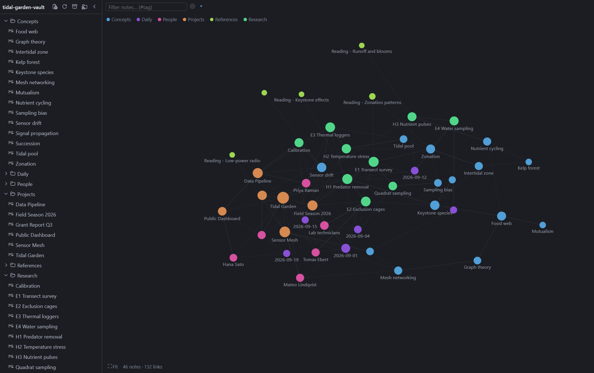
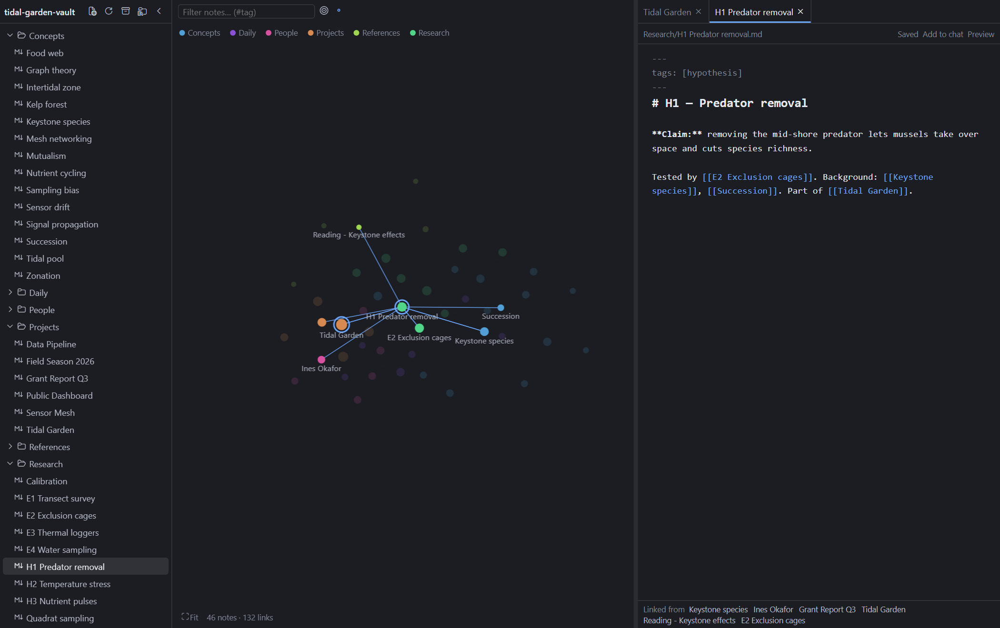
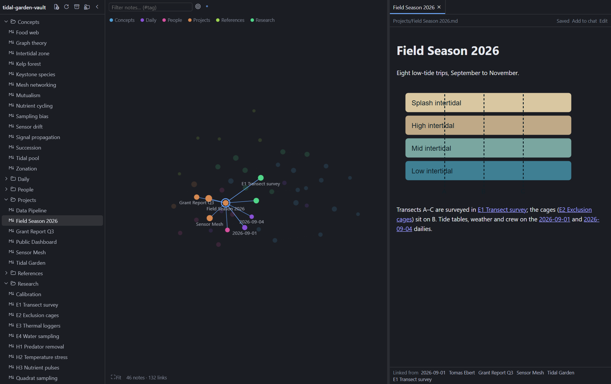
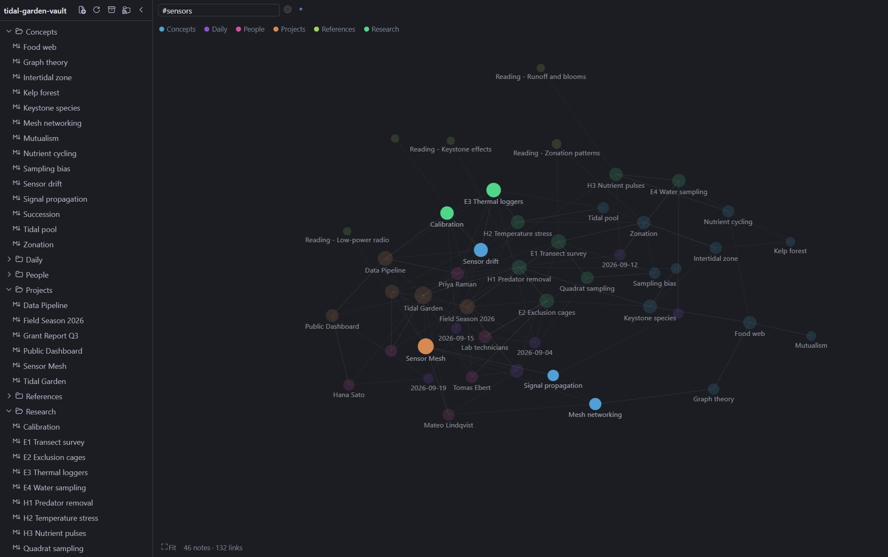
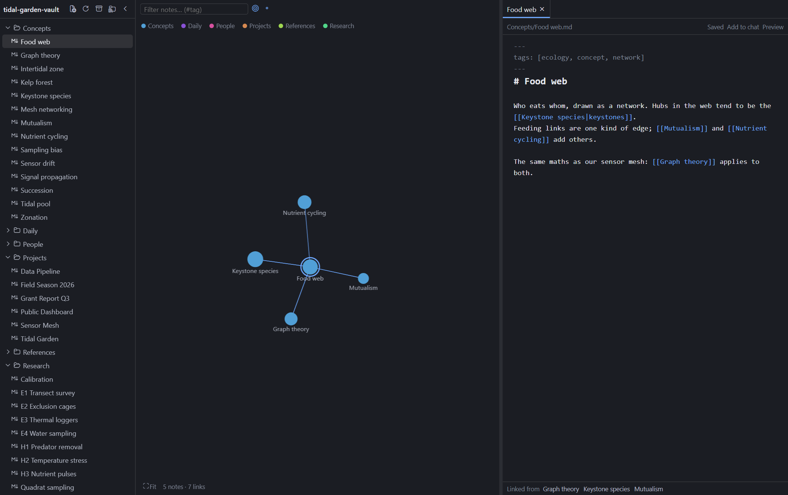

# Plexus

A [Hermes Desktop](https://hermes-agent.nousresearch.com) plugin that opens a local markdown vault (Obsidian-style `[[wikilinks]]`) as **one tab in the main workspace**: a collapsible file tree, a force-directed graph of your notes, and a tabbed editor pane behind a divider that can collapse either side completely.



**Local only.** Notes are read and written through the desktop app's Electron file bridge on the machine running Hermes Desktop. There is no backend, REST route, network access, or agent tool. Hermes' own agent keeps using whatever it already uses for notes.

## Use

Open it from the command palette (**Open Vault**) or **Ctrl/⌘+Shift+G** (rebindable in Hermes settings). On first open, choose the folder that holds your notes. Settings live under **Settings → Plugins → Plexus**.

| Area | What it does |
|---|---|
| **File tree** (left, collapsible) | `.md` notes by folder. New, rename, move to trash (recoverable), drag a note onto a folder to move it. Keyboard: arrows, Enter, F2 to rename. `archive`/`_archived` and dot-folders are skipped by default (configurable). The active note is revealed automatically. |
| **Graph** (centre) | Notes are nodes, `[[wikilinks]]` are edges, clustered and coloured by top-level folder. Wheel zooms, drag pans or moves a node, click opens a note, Shift+click pins a node. Filter box (`#tag` too), local graph (this note + neighbours), show/hide unlinked notes, click the legend to hide a folder. Arrow keys hop between linked notes, Enter opens, P pins. Layout is remembered per vault. Notes changed by something else (e.g. the agent) get a dashed halo for ten minutes. |
| **Note pane** (right, appears when a note is open) | A tab per note, markdown editor with autosave, `[[` autocomplete, Ctrl/⌘-click on a wikilink to follow it (a missing target is created next to the current note), Edit/Preview toggle, backlinks list, and **Add to chat** (inserts `@file:<path>` into the composer). Drag the divider to 0% or 100% to hide either side; double-click resets it; it is also keyboard-operable. |

Open tabs, the active note, expanded folders, pinned nodes and graph layout are remembered per vault. A clean open note reloads itself when it changes on disk; if you have unsaved edits when that happens, saving is refused until you choose **Reload from disk** or **Overwrite**.

**Links.** `[[Note]]`, `[[Note#Heading]]` and `[[Note#^block]]` open the note and jump to the heading or block (in the editor and in Preview). In Preview, `![[image.png|300]]` and `` show vault images, and `![[Note]]` / `![[Note#Heading]]` embed that note or section.

**From chat.** The plugin registers a transcript directive, so the agent can link a note in its reply and you can open it with one click:

```
::vault{note="Projects/Hermes setup#Install"}
```

The chip opens (or re-fronts) the Vault tab on that note. A name that does not exist is reported, never created. Hermes' agent only knows about the directive if you tell it; add something like this to a skill or `SOUL.md`:

> When you mention a note from the user's Obsidian vault, link it with `::vault{note="<Folder/Note name>"}` (optionally `#Heading`) on its own line instead of pasting its path.

Renaming or moving a note rewrites the links that pointed at it (aliases, headings and embeds preserved; links inside code are left alone). Notes with unsaved edits are skipped and reported.

## Screenshots

| | |
|---|---|
|  |  |
| Editor beside the graph; the divider can collapse either side. | Preview renders images, links and note embeds. |
|  |  |
| The filter dims everything that does not match (`#tag` works too). | Local graph: the open note and its neighbours. |

These are rendered from the **fictional demo vault** in `demo/vault` (a made-up tide-pool research project; every name and result is invented) by a small harness that mounts the real plugin components in headless Edge/Chrome. Only the host app around them (Hermes' SDK, theme colours, markdown renderer) is simulated, so treat them as representative rather than literal Hermes Desktop captures. Regenerate with `node scripts/screenshots.mjs`; set `PLEXUS_EVAL="<js>"` to print an expression evaluated in the settled page when debugging a layout.

To try the plugin without your own notes, choose `demo/vault` as the vault folder (or run `node demo/make-vault.mjs` to recreate it).

## Install

Copy `desktop/plugin.js` to `<HERMES_HOME>/desktop-plugins/hermes-plexus/plugin.js` (the folder name must equal the plugin id), or from a checkout:

```
npm install
npm run deploy      # builds, then copies into <HERMES_HOME>/desktop-plugins/hermes-plexus/
```

Hermes watches that folder and hot-reloads the plugin on every save; no rebuild of the desktop app is needed. Requires Hermes Desktop with `host.openWorkspace` (≥ 0.21.5 per the SDK docs).

## Develop

```
npm test            # builds desktop/plugin.js, then runs unit, component and bundle smoke tests
npm run typecheck
```

`src/model.ts` (links, tags, graph, rewriting), `src/store.ts` (scanning, tabs, file operations) and `src/vault-fs.ts` (the disk door) are framework-free and tested against an in-memory disk (`test/fake-disk.ts`). `test/bundle.test.tsx` loads the **built** file against a stub SDK.

## Known limits

- No live file watching: the vault rescans when the window regains focus (full re-read up to 1,500 notes, folder listing only above that), after saves, and on the rescan button.
- A save is check-then-write; the bridge has no compare-and-swap, so an edit made by another program in the few milliseconds between the check and the write can be lost.
- Notes over the bridge's 512 KiB preview cap open read-only. Images are shown in Preview only; other attachments (PDFs, audio) are not handled. Embedded notes render two levels deep.
- The editor's highlighting is regex-based, not a full markdown parser.
- UI strings are English only; add a locale object in `src/i18n.ts`.

## Build notes

`desktop/plugin.js` is the **built** bundle and is committed, because that is the file Hermes installs and loads (`hermes plugins validate .` checks it). Rebuild it with `npm run build` after changing `src/`; `npm test` rebuilds it first.

One line of a dependency is rewritten at build time (`scripts/build.mjs`): `@codemirror/language` extends its own `EditorState` class with `Object.defineProperty(EditorState.prototype, "tree", …)`. That is a bundled library adjusting a class it ships, which the catalog rules allow, but Hermes' static admission lint matches the literal `Object.defineProperty(<X>.prototype` and cannot tell the difference. The build swaps it for the equivalent `Reflect.defineProperty`, and fails if the library's line ever changes so the rewrite cannot go stale.

## License

MIT
