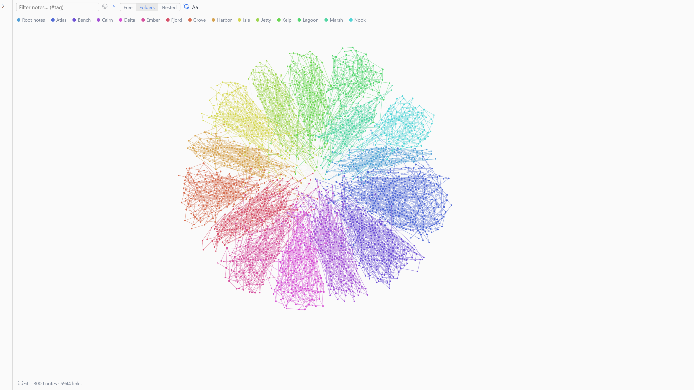
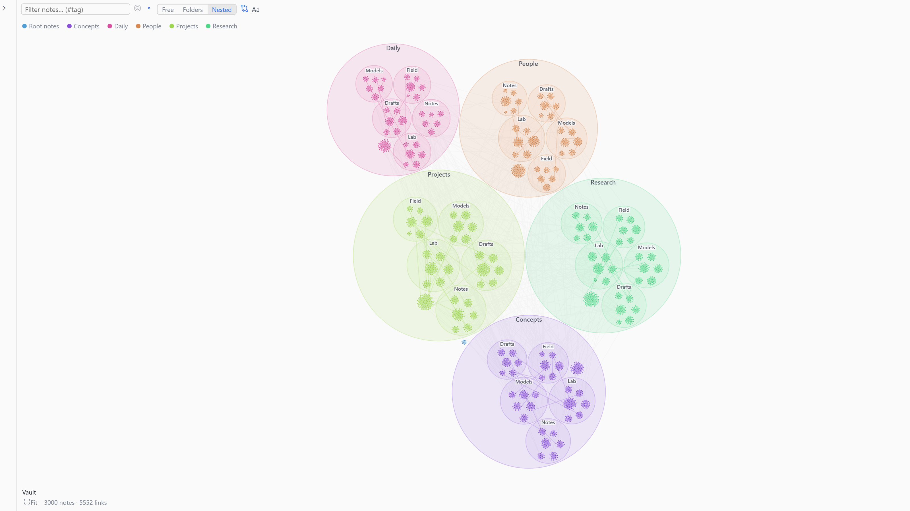
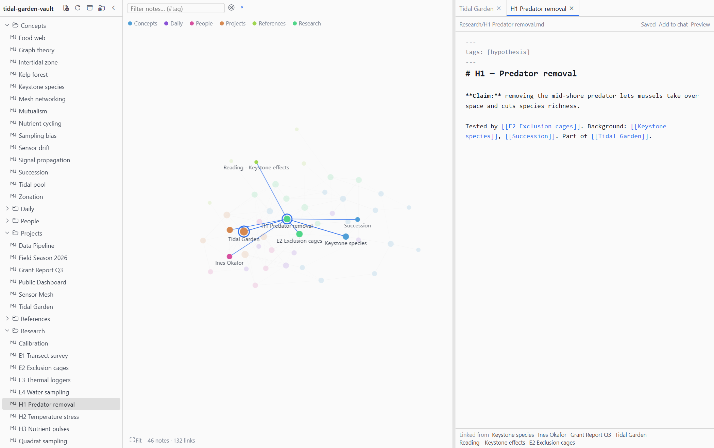
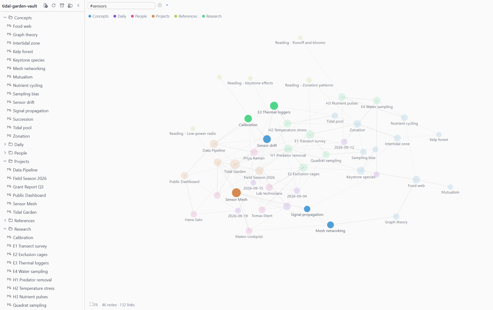
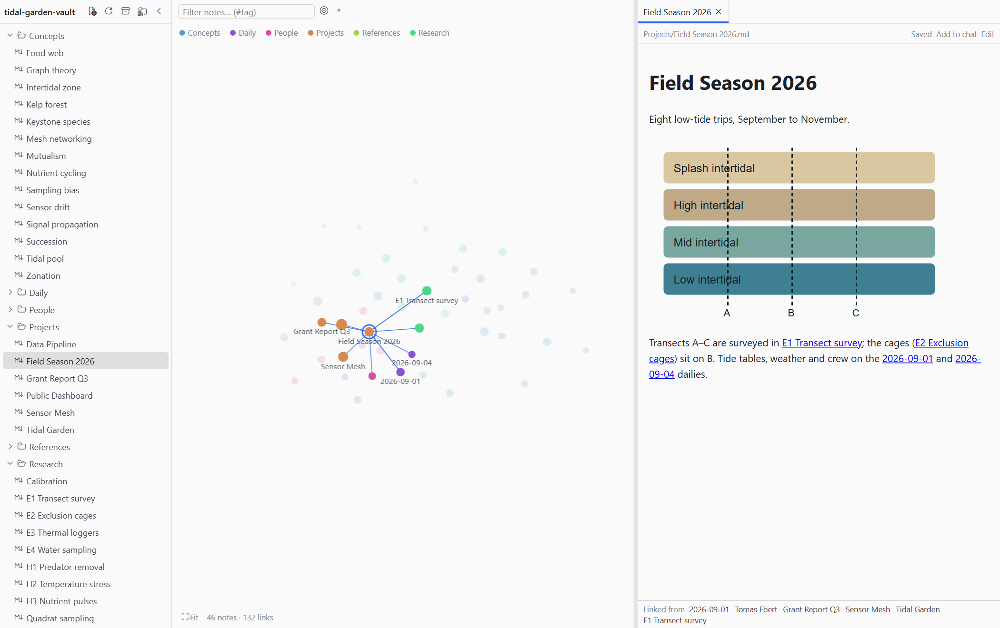

<div align="center">

# Plexus

Your markdown vault as a constellation, inside [Hermes Desktop](https://hermes-agent.nousresearch.com). A graph of your notes and their `[[wikilinks]]`, a file tree, and a tabbed editor, together in one tab. Fully local; your notes stay on your machine. Unofficial: not affiliated with Nous Research or Obsidian.

[](LICENSE)
[](#privacy)

<picture>
  <source media="(prefers-color-scheme: dark)" srcset="docs/screenshots/hero-dark.png">
  
</picture>

</div>

---

## Features

- **Graph.** Notes are nodes, wikilinks are edges, and each top-level folder gets its own colour. Scroll to zoom, drag to pan or move a note, click to open, Shift+click to pin. The filter box dims what does not match (`#tag` works too), the target button shows only the open note and its neighbours, and the legend hides whole folders.
- **Nested folders.** Switch the layout to **Nested** and every folder becomes a region inside its parent, with its notes inside it. Click a folder's name to zoom in, press Escape to zoom out, and press **H** to hide a folder you do not want in the picture.
- **File tree.** Create, rename, move, and trash notes. Renaming or moving a note updates the links that point to it.
- **Editor.** Markdown with autosave, `[[` completion, Ctrl/⌘-click to follow a link, an Edit/Preview toggle, and a backlinks list. Drag the divider to give the graph or the editor the whole tab.
- **Wikilinks.** `[[Note]]`, `[[Note#Heading]]` and `[[Note#^block]]` jump to the right place; Preview shows images and embedded notes.
- **Safe saves.** If a note changes on disk while you have unsaved edits, Plexus asks whether to reload or overwrite instead of silently choosing.
- **Remembers where you were.** Open tabs, expanded folders, pinned notes, and the graph layout are kept per vault, and you can switch between vaults.

<div align="center">
<table>
  <tr>
    <td width="50%">
      <picture>
        <source media="(prefers-color-scheme: dark)" srcset="docs/screenshots/hero-nested-dark.png">
        
      </picture>
    </td>
    <td width="50%">
      <picture>
        <source media="(prefers-color-scheme: dark)" srcset="docs/screenshots/editor-dark.png">
        
      </picture>
    </td>
  </tr>
  <tr>
    <td align="center"><sub>Nested folders: every folder a region inside its parent.</sub></td>
    <td align="center"><sub>Editor beside the graph; the open note and its neighbours light up.</sub></td>
  </tr>
  <tr>
    <td width="50%">
      <picture>
        <source media="(prefers-color-scheme: dark)" srcset="docs/screenshots/search-dark.png">
        
      </picture>
    </td>
    <td width="50%">
      <picture>
        <source media="(prefers-color-scheme: dark)" srcset="docs/screenshots/preview-dark.png">
        
      </picture>
    </td>
  </tr>
  <tr>
    <td align="center"><sub>Filtering by <code>#sensors</code> dims the rest.</sub></td>
    <td align="center"><sub>Preview with an image, links and backlinks.</sub></td>
  </tr>
</table>
</div>

The screenshots come from fictional demo vaults (a made-up tide-pool research project and generated ones), rendered by a small harness that runs the real plugin outside Hermes. Treat them as representative rather than literal captures.

## Install

Install **Plexus** from Hermes Desktop's plugin marketplace (**Settings → Plugins**). Then open it from the small **Vault** button at the bottom-right of the Hermes window (in the status bar, easy to miss), the command palette (**Open Vault**), or **Ctrl/⌘+Shift+G**, and choose the folder that holds your notes. Plexus settings are under **Settings → Plugins → Plexus**.

To look around without your own notes, choose the `demo/vault` folder from this repository.

## Using it with the agent

**Link notes from chat.** Add a line like this to a skill or `SOUL.md` and the agent can point at a note; you open it with one click:

> When you mention a note from the user's Obsidian vault, link it with `::vault{note="<Folder/Note name>"}` (optionally `#Heading`) on its own line instead of pasting its path.

A note that does not exist is reported, never created.

**Add a note to chat.** The note pane's **Add to chat** button puts a reference to the note in the composer.

## Privacy

Plexus only reads and writes inside the vault folder you choose, which Hermes lists (and lets you revoke) under its folder-access settings. Deleting moves a note to the system trash. Settings, open tabs, and graph layout are stored by Hermes on your machine. Nothing is sent anywhere; the one opt-in exception is images that a note links from the web, which stay as placeholders until you click **Load remote images** (that tells the image's host your IP address). Folders starting with a dot (`.obsidian`, `.git`) and `archive`/`_archived` are skipped by default.

## Known limits

- No live file watching: the vault refreshes when the window regains focus, after saves, and with the rescan button.
- A note that is not UTF-8 text or is larger than 4 MiB cannot be opened. Images show in Preview only; other attachments (PDFs, audio) are not handled.
- If another program edits a note in the instant between Plexus checking it and saving it, that edit can be lost.
- The editor's highlighting is simple, and the interface is English only.

## Development

```
npm install
npm run verify                    # typecheck, tests, and a check that the committed bundle matches the sources
npm run deploy                    # build and install into your local Hermes (for trying changes)
node scripts/screenshots.mjs      # re-render docs/screenshots from the demo vaults
node scripts/bench.mjs            # layout cost and boundary crowding
```

`desktop/plugin.js` is the built bundle Hermes loads; it is committed and rebuilt by `npm run build`. Design notes are in [docs/](docs).

<div align="center">

## Support

Free and open source. If it saved you time, you can chip in toward its upkeep.

<a href="https://ko-fi.com/Q5Q11I49GI"></a>
<a href="https://liberapay.com/mr-september/donate"></a>
<a href="https://www.paypal.com/donate/?hosted_button_id=WFXL2T42BBCRN"></a>
<a href="https://nowpayments.io/donation?api_key=5b5fabd5-2c33-4525-99a3-bf27f587780c"></a>

Stars, bug reports, and ideas for the graph help just as much.

</div>

## License and credits

The code is [MIT](LICENSE) licensed. The built bundle includes [CodeMirror 6](https://codemirror.net/) (MIT) and [d3-force](https://github.com/d3/d3-force) and [d3-hierarchy](https://github.com/d3/d3-hierarchy) (ISC); `@vscode/codicons` and `marked` are used only by the screenshot harness. "Obsidian" is a trademark of its owners; this project is not affiliated with or endorsed by them. Every person and result in the demo vault is fictional.
